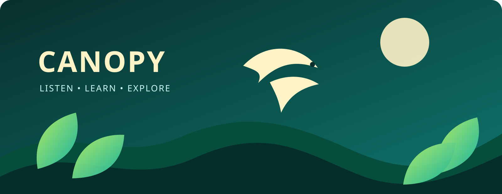
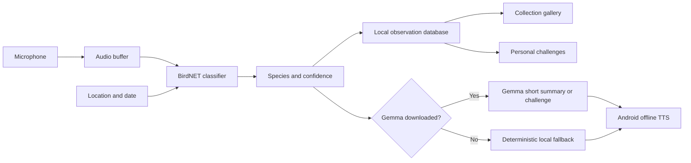

# Canopy

<p align="center">
  
</p>

<p align="center">
  <strong>Private, local-first bird intelligence for curious listeners.</strong><br>
  Identify birds from sound, build a personal collection, and turn every walk into a challenge.
</p>

<p align="center">
  <a href="https://github.com/atharhive/canopy/releases/tag/v5.4.0-gemma-beta"></a>
  <a href="https://github.com/atharhive/canopy/releases"></a>
  <a href="https://github.com/atharhive/canopy/blob/main/LICENSE"></a>
  <a href="#demo-video"></a>
</p>

<p align="center">
  
  
  
  
  
  
  
  
  
  
  
</p>

<p align="center">
  <a href="#getting-started">Getting started</a> ·
  <a href="#how-it-works">How it works</a> ·
  <a href="#features">Features</a> ·
  <a href="#roadmap">Roadmap</a>
</p>

> **Beta:** Download [Canopy 5.4.0 Local Gemma Beta](https://github.com/atharhive/canopy/releases/tag/v5.4.0-gemma-beta).
>
> **Demo video:** _Coming soon — this space is reserved for the walkthrough video._

## What is Canopy?

Canopy is an Android app that listens for bird sounds and uses the local BirdNET
recognition pipeline to identify likely species. It keeps observations on the
device, turns detections into collectible field cards, and optionally uses a
downloaded Gemma model to create short explanations, challenges, and answers
without sending the user's recordings or collection to a server.

<details>
<summary><strong>Why Canopy?</strong></summary>

- Birding should be approachable even when you do not know what to look for.
- Audio-first exploration lets people keep their eyes on the trail.
- Local processing keeps recordings and location history under the user's control.
- Progress, cards, and challenges make repeated listening feel rewarding.

</details>

## Features

<details>
<summary><strong>Recognition and narration</strong></summary>

- BirdNET-powered microphone detection.
- Location-aware recognition using the BirdNET metadata model.
- Adjustable confidence threshold and audio source.
- Optional Android offline text-to-speech summaries.
- Optional local Gemma summaries; BirdNET remains the source of truth.
- No ElevenLabs or cloud voice dependency in the local-first build.

</details>

<details>
<summary><strong>Collection and challenges</strong></summary>

- Gallery cards for every unique detected species.
- Best confidence, observation count, and collection date.
- Thirteen deterministic challenges that work without Gemma.
- Optional Gemma-generated challenges based only on collected species.
- Offline question box for asking Gemma about the collection and birding.

</details>

<details>
<summary><strong>Exploration tools</strong></summary>

- Guided simulated demo with a generated chirp.
- Manual latitude/longitude entry with range validation.
- Location-aware observations and history.
- Optional spectrogram and WAV capture.
- Bluetooth audio input support.
- Language and high-contrast settings.

</details>

## Demo video

The product walkthrough video is being prepared. This section will be updated
with the YouTube link once the recording is published.

## How it works



<details>
<summary><strong>Data and privacy flow</strong></summary>

1. Audio is captured on the device.
2. BirdNET performs the recognition locally.
3. Species, confidence, time, and location are stored in the local database.
4. Gemma receives structured detection or collection text only when enabled.
5. Android TTS speaks the result locally.
6. ElevenLabs is intentionally not used in this release.

</details>

## Getting started

### Download the beta

1. Open the [Canopy beta release](https://github.com/atharhive/canopy/releases/tag/v5.4.0-gemma-beta).
2. Download `Canopy-5.4.0-gemma-beta.apk`.
3. Optionally download the `.sha256` checksum file.
4. On Android, allow installation from the source you used to download the APK.
5. Open Canopy and download the BirdNET model when prompted.

The optional Gemma model is downloaded separately from inside the app and is
approximately 529 MB. Canopy remains usable without it.

### Build from source

<details>
<summary><strong>Requirements and project setup</strong></summary>

- Android Studio with Android SDK API 35.
- JDK 17.
- Android device or emulator running Android 8.0/API 26 or newer.
- Approximately 2 GB of free space for optional Gemma model testing.

```bash
git clone https://github.com/atharhive/canopy.git
cd canopy
```

Open the cloned folder in Android Studio, allow the Gradle sync to finish, and
select the `app` run configuration. Android Studio will use the Gradle wrapper
included in the repository.

</details>

<details>
<summary><strong>Build and install</strong></summary>

```bash
./gradlew assembleDebug
```

The debug APK is generated at:

```text
app/build/outputs/apk/debug/app-debug.apk
```

Install it on a connected device with:

```bash
adb install -r app/build/outputs/apk/debug/app-debug.apk
```

</details>

<details>
<summary><strong>Run, test, and release</strong></summary>

1. Grant microphone and location permissions when Canopy requests them.
2. Use **Try a demo** to preview the interface without downloading BirdNET.
3. Download the BirdNET model from the model screen.
4. Start detection and test with real outdoor bird sounds.
5. Open the collection icon to review cards and challenges.
6. Download Gemma only if the device has enough storage and memory.
7. Enable Gemma summaries to try local explanations and custom challenges.
8. Disable Gemma to verify that the offline fallback summaries still work.

#### Build the optimized release

```bash
./gradlew assembleRelease
```

The release build requires a signing keystore. Never commit the keystore,
passwords, or signing properties to the repository. For ordinary development,
the debug build is the recommended option.

</details>

## Release verification

### 5.4.0 Local Gemma Beta

- Tag: [`v5.4.0-gemma-beta`](https://github.com/atharhive/canopy/releases/tag/v5.4.0-gemma-beta)
- APK: `Canopy-5.4.0-gemma-beta.apk`
- SHA-256: `edb7e6eb1d0f328030c9c092c0171c9db1b6b539c910a322a5b66c92f464f337`
- Gemma: Gemma 3 1B instruction-tuned int4, downloaded separately.

## Model and licensing

Canopy source code is distributed under the [GNU General Public License v3](LICENSE).
BirdNET model files are distributed separately from the app and have their own
license and usage restrictions. Review those terms before redistributing the
model or using a build commercially.

The optional Gemma model is downloaded from the model host and is subject to
Google/Gemma model terms. Users should review and accept those terms where
required before downloading or redistributing it.

## Roadmap

<details>
<summary><strong>Planned improvements</strong></summary>

- Walk/session summaries.
- Better collection filters and card artwork.
- Device-specific Gemma performance guidance.
- More accessibility refinements.
- A recorded product walkthrough.

</details>

## Contributing

Contributions are welcome. Please use the following workflow so changes are
easy to review, test, and merge.

<details>
<summary><strong>1. Set up your fork</strong></summary>

1. Fork [Canopy on GitHub](https://github.com/atharhive/canopy).
2. Clone it and add the upstream repository:

   ```bash
   git clone https://github.com/YOUR_USERNAME/canopy.git
   cd canopy
   git remote add upstream https://github.com/atharhive/canopy.git
   git fetch upstream
   git checkout main
   git pull upstream main
   git checkout -b fix/short-description
   ```

</details>

### 2. Make and test your change

- Keep each pull request focused on one feature, fix, documentation update, or
  accessibility improvement.
- Follow the existing Kotlin, Java, Android XML, and Gradle conventions.
- Keep recordings, observations, locations, credentials, signing keys, and
  model secrets out of commits.
- Build the project before submitting:

  ```bash
  ./gradlew assembleDebug
  ```

- Test on an Android device or emulator when the change affects runtime
  behavior.
- Test both the normal path and offline fallback when changing Gemma,
  narration, downloads, or challenges.
- Include screenshots or a short screen recording for UI changes.

<details>
<summary><strong>3. Open a pull request</strong></summary>

Before opening the pull request:

```bash
git diff upstream/main...HEAD
git status
git push origin fix/short-description
```

The pull request description should explain:

- What changed and why.
- How the change was tested.
- Device model and Android API level, if relevant.
- Any known limitations, migration steps, or follow-up work.

Please search existing issues before creating a duplicate. Be respectful and
constructive in reviews. During Hacktoberfest, meaningful documentation,
testing, accessibility, UI, and carefully scoped bug-fix contributions are
especially welcome; duplicate or drive-by formatting pull requests may be
closed.

</details>

<p align="center">Built with ❤️ during Hacktoberfest.</p>
